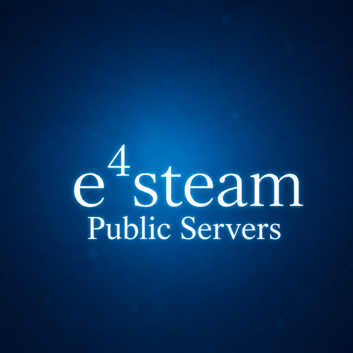

<p align="center">
  
</p>

<h1 align="center">e4steam Public Servers</h1>

<p align="center">Найди открытый мир и присоединись к игре через Steam.<br>Find an open world and join through Steam.</p>

<p align="center"><b>Kamilchik · K2 Studio</b><br>Fabric · Quilt · Forge · NeoForge · Minecraft 1.17–26.3</p>

<p align="center">
  <a href="https://discord.gg/zFvrHz2ys7" title="Discord K2 Studio"></a>
  <a href="https://t.me/Kamilchikm" title="Telegram Kamilchik"></a>
  <a href="https://t.me/K2Studio_Dev" title="Telegram K2 Studio"></a>
  <a href="https://dalink.to/kamilchik1231" title="Поддержать разработку / Donate"></a>
  <a href="https://www.curseforge.com/minecraft/mc-mods/e4steam" title="e4steam CurseForge"></a>
  <a href="https://github.com/Kamilhik/e4steam" title="e4steam GitHub"></a>
  <a href="https://github.com/K2-Studio-Development/e4steam-Friends" title="e4steam Friends"></a>
  <a href="https://modrinth.com/project/SqqdJF90" title="e4steam Modrinth"></a>
  <a href="https://youtu.be/KJ1W_eJ2VK4" title="Видео / Video"></a>
</p>

<p align="center">
  <a href="https://github.com/K2-Studio-Development/e4steam-Public-Servers/releases">Скачать / Download</a> ·
  <a href="#установка">Установка</a> ·
  <a href="#совместимость">Версии</a> ·
  <a href="#english">English</a> ·
  <a href="https://github.com/K2-Studio-Development/e4steam-Public-Servers/issues">Сообщить об ошибке</a>
</p>

## Как это работает

Public Servers добавляет в Minecraft каталог общих миров e4steam. Хост открывает свой мир для всех, а другие игроки находят его в списке и подключаются. Каталог использует Steam, поэтому отдельный сайт, домен и API-ключ не нужны.

В списке можно искать мир по имени, показывать только совместимые версии и отбирать серверы со свободными местами. Рядом с названием видно количество игроков. Длинный список прокручивается колесом мыши или ползунком; если все строки помещаются в окне, ползунок скрывается.

Интерфейс доступен на русском и английском; для старых версий Minecraft предусмотрены совместимые экраны.

> **Выделенные серверы пока не публикуются через Steam-каталог.** Сейчас в нём доступны открытые миры игроков. Вкладка «Выделенные» может быть пустой.

## Установка

Нужны совместимое ядро e4steam 0.3.2-beta.1 или новее с Addon API 1.1, подходящий загрузчик и Steam с выполненным входом в аккаунт. Установи ядро и аддон на обоих компьютерах. Для beta.18 используй обновлённую сборку ядра с исправлениями LAN и Steam.

1. Скачай JAR ядра [e4steam](https://github.com/Kamilhik/e4steam) и [Public Servers](https://github.com/K2-Studio-Development/e4steam-Public-Servers/releases) для своей версии Minecraft и загрузчика.
2. Положи оба файла в папку `mods`. Для Fabric или Quilt также установи подходящий Fabric API или Quilted Fabric API.
3. Запусти Steam и Minecraft.

### Открыть свой мир

В одиночном мире выбери «Открыть для сети», затем в настройке доступа через Steam выбери «Общий сервер». Подтверди публикацию, задай имя и открой мир. По умолчанию имя выглядит так: `<ник хоста> server`. Лимит игроков учитывает хоста.

### Присоединиться

Открой сетевую игру, затем каталог Public Servers. Выбери мир и нажми «Подключиться».

Список обновляется каждые 10 секунд. Объявление без обновлений исчезает через 45 секунд. Миры с доступом только для друзей или по приглашению в общий список не попадают. e4steam проверяет подлинность Steam-подключения и разрешение на вход.

## Совместимость

| Minecraft | Загрузчик / Loader | Java¹ |
| --- | --- | ---: |
| 1.17–1.18.2 | Fabric / Quilt | 16+ |
| 1.17.1–1.18.1 | Forge | 16+ |
| 1.19–1.21.11 | Fabric / Quilt | 17+ |
| 1.18.2–1.20.2 | Forge | 17+ |
| 1.20.2–1.21.11 | NeoForge | 17+ |
| 26.1–26.3 | Fabric / Quilt | 25+ |
| 26.1–26.3 | NeoForge | 25+ |

¹ Это минимальная версия Java для байткода аддона. Сама игра и загрузчик могут требовать более новую Java, особенно в диапазоне 1.19–1.21.11.

<details>
<summary>Как выбрать JAR по имени файла / JAR filename guide</summary>

В имени JAR указаны загрузчик и диапазон Minecraft. Перед версией аддона ищи одну из этих частей:

| Сборка | Часть имени JAR |
| --- | --- |
| Fabric / Quilt 1.17–1.18.2 | `fabric-quilt-mc1.17-1.18.2` |
| Forge 1.17.1–1.18.1 | `forge-mc1.17.1-1.18.1` |
| Fabric / Quilt 1.19–1.21.11 | `fabric-quilt-mc1.19-1.21.11` |
| Forge 1.18.2–1.20.2 | `forge-mc1.18.2-1.20.2` |
| NeoForge 1.20.2–1.21.11 | `neoforge-mc1.20.2-1.21.11` |
| Fabric / Quilt 26.1–26.3 | `fabric-quilt-mc26.1-26.3` |
| NeoForge 26.1–26.3 | `neoforge-mc26.1-26.3` |

</details>

## English

Public Servers adds a catalog of public e4steam worlds to Minecraft. A host opens a world to everyone; other players find it in the catalog and join through Steam. It does not need a separate website, domain or API key.

Search by world name, filter for compatible versions or free slots, and check player counts before joining. Long lists support the mouse wheel and a draggable scrollbar. The scrollbar stays hidden when every row fits.

The interface supports English and Russian, with compatible screens for older Minecraft releases.

**Dedicated servers are not published through the Steam catalog yet.** The current catalog lists integrated player worlds; the dedicated-server tab may be empty.

### Install and play

Install a compatible e4steam 0.3.2-beta.1 or newer core with Addon API 1.1 and the matching Public Servers JAR on both computers. For beta.18, use an updated core build with the LAN and Steam fixes. Both players need a signed-in Steam client. The [compatibility table](#совместимость) lists loader and Java requirements; Minecraft or the loader may require a newer Java version than the addon's bytecode minimum.

1. Download the core and addon JARs for your Minecraft version and loader, then place them in `mods`. Add the matching Fabric API or Quilted Fabric API when required.
2. Host: open a singleplayer world, choose **Open to LAN**, set Steam access to **Public Server**, confirm publication and enter a name. The default name is `<host nickname> server`; the player limit includes the host.
3. Guest: open Multiplayer, enter **Public Servers**, select the world and connect.

The catalog refreshes every 10 seconds. Advertisements expire after 45 seconds without an update. Friends-only and invitation-only worlds stay out of the public list. e4steam handles Steam authentication and admission checks.

## Для разработчиков / Development

Для сборки всех семи вариантов нужны JDK 17 и JDK 25:

```sh
./gradlew verification releaseArtifactAudit --no-configuration-cache
```

На Windows используй `gradlew.bat`. Готовые JAR находятся в `build/release/`. Addon API берётся из Maven Central как compile-only зависимость; его классы не входят в JAR аддона.

Use JDK 17 and JDK 25 to build all seven targets. On Windows, use `gradlew.bat`. Runtime JARs are collected in `build/release/`. The Addon API is a compile-only Maven Central dependency and is not bundled in addon JARs.

Проверка артефактов сверяет метаданные загрузчика, авторов, иконку и версию байткода, а также исключает временный сайт статуса. В beta.18 его HTTP-сервер удалён из всех JAR. Подробности выпуска: [Changelog](CHANGELOG.md).

Automated checks cover the domain, client, backend and all seven runtime artifacts. The audit checks loader metadata, authors, icon, bytecode and the absence of the removed local status website. See [Testing](docs/TESTING.md) for in-game results and remaining checks. A successful build does not replace testing every game version with two Steam accounts.

<details>
<summary>Документация / Documentation</summary>

- [Архитектура / Architecture](docs/ARCHITECTURE.md)
- [Каталог Steam / Steam discovery](docs/STEAM_DIRECTORY.md)
- [Протокол / Protocol](docs/REGISTRY_PROTOCOL.md)
- [Безопасность / Security](docs/SECURITY.md)
- [Приватность / Privacy](docs/PRIVACY.md)
- [Разработка / Development](docs/DEVELOPMENT.md)
- [Развёртывание / Deployment](docs/DEPLOYMENT.md)
- [Проверки / Testing](docs/TESTING.md)
- [Сторонние компоненты / Third-party notices](THIRD_PARTY_NOTICES.md)

В репозитории есть отдельный HTTP registry для разработки и развёртывания серверного каталога. Он не запускает HTTP-сервер внутри аддона. Настройка описана в руководстве по развёртыванию.

The repository also contains a separate HTTP registry backend for development and deployment. It does not start an HTTP listener inside the addon. See the deployment guide for configuration.

</details>

## Лицензия / License

[Apache License 2.0](LICENSE). Minecraft is a trademark of Microsoft/Mojang Studios; Steam is a trademark of Valve Corporation. This project is not affiliated with either company.
